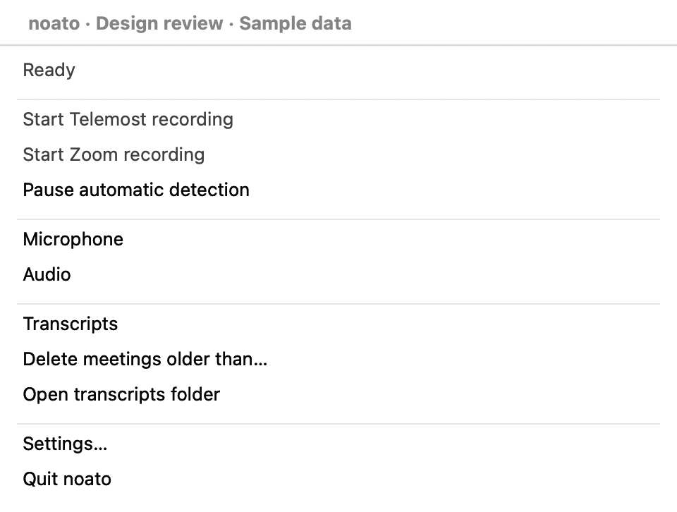
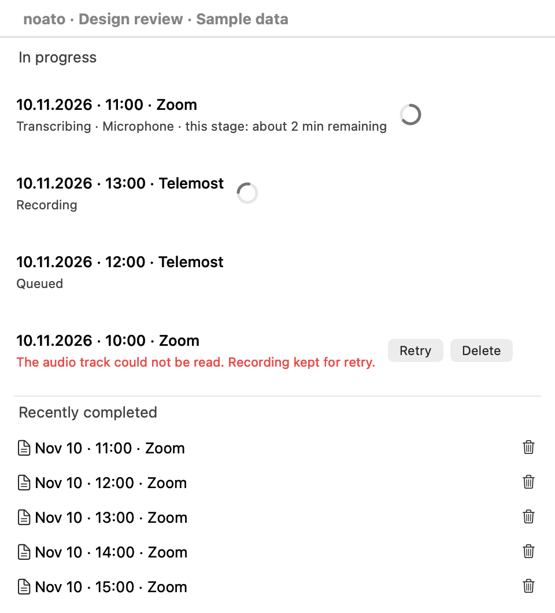

# noato

**Your meetings, kept local.** A macOS menu bar app that records Zoom and Telemost and creates Markdown transcripts with timestamps and speaker labels. Powered by local Whisper. No account. No audio uploads.

## Installation

Ask your coding agent to install and set up noato on your Mac:

```text
Read https://raw.githubusercontent.com/luntikius/noato/v0.1.0-beta.1/skills/install-noato/SKILL.md
and follow it to install and set up noato v0.1.0-beta.1 on this Mac.
```

The [installation skill](skills/install-noato/SKILL.md) and [setup instructions](docs/installation.md) cover requirements, installation and first launch. Requires Apple Silicon and macOS 15+.

## Use

- Start Zoom or Telemost recording from the menu bar. The icon turns **red** while recording; choose **Stop recording** to finish.
- Choose your microphone and app audio independently. For Bluetooth headphones, select the Mac microphone to avoid using the headset microphone.
- Open **Transcripts** for progress, time estimates, queued jobs and the five latest transcripts. Click a completed meeting to open it; the trash button asks for confirmation.
- After successful processing, only Markdown remains. Failed jobs keep audio for retry. Recordings under **10 seconds** are skipped by default.

Russian is the default transcription language. Your microphone is labeled `me`; remote speakers are `participant_N`. Language and speaker settings are configurable.

**Limitations:** automatic detection follows audio activity and can trigger outside meetings; use manual recording when needed. Native Zoom and Telemost are supported; browser meetings and Intel Macs are outside this beta. Optional age-based deletion includes unprocessed audio, while active jobs are protected.

## Screenshots

Native interface previews with sample meetings; [rendering details](docs/screenshots/README.md).

| Menu controls | Progress and recent transcripts |
| --- | --- |
| <picture><source media="(prefers-color-scheme: dark)" srcset="docs/screenshots/dark-menu-idle.png"></picture> | <picture><source media="(prefers-color-scheme: dark)" srcset="docs/screenshots/dark-transcripts.png"></picture> |

See the [usage guide](docs/usage.md) for settings, storage, cleanup and CLI commands, or [development notes](docs/development.md) for builds and tests.

## Credits

Based on [Quill by kukutz](https://github.com/kukutz/quill), with the original [MIT license](LICENSE) retained. [Third-party notices](THIRD_PARTY_NOTICES.md).
