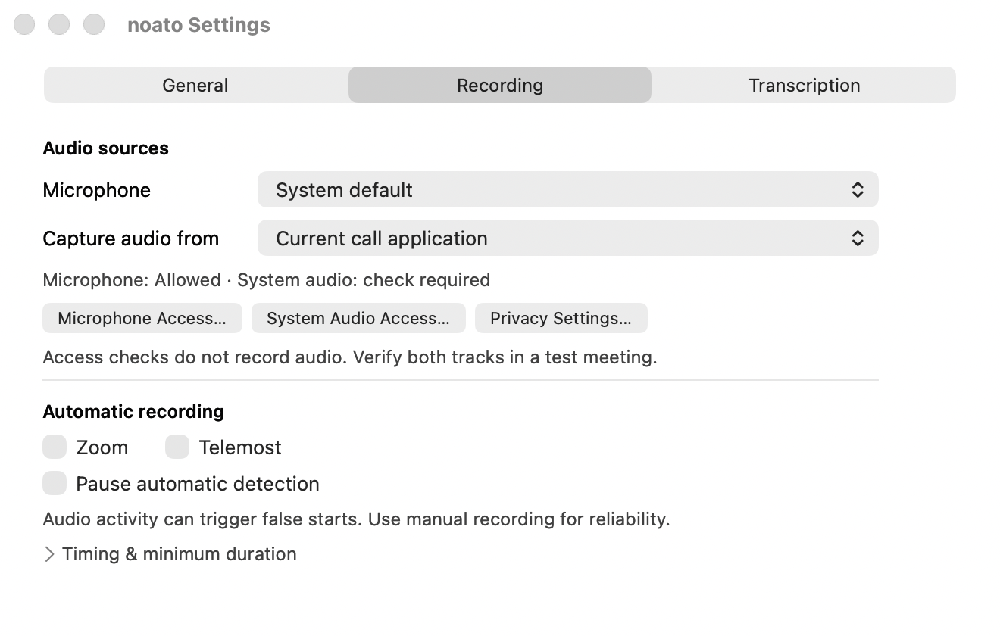
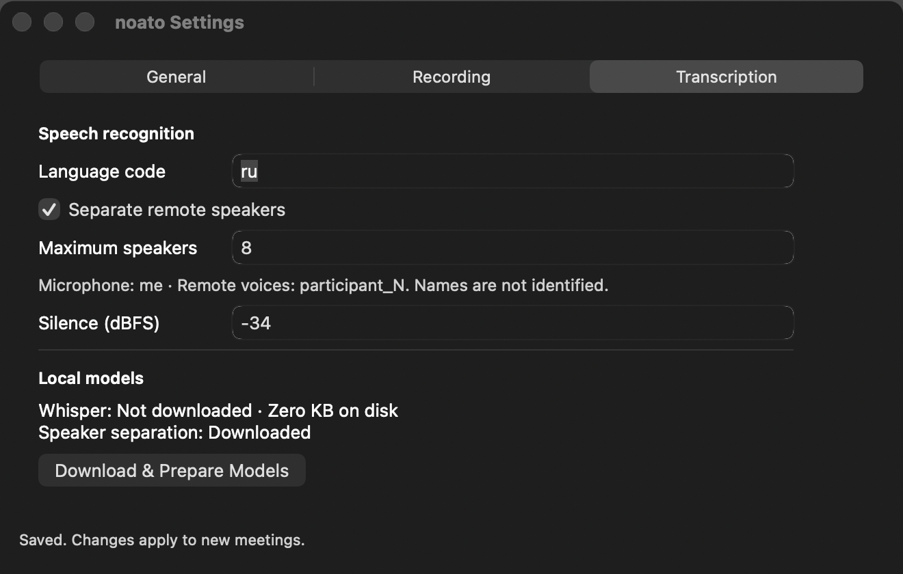

# Using noato

[Back to README](../README.md)

## First launch

1. Open `~/Applications/noato.app`. Its **n + dot** icon appears in the menu bar; there is no permanent Dock icon.
2. Choose the transcript folder. New installations default to `~/Documents/noato`. An existing Quill configuration can be imported, keeping its folder, microphone choice and pending work and reusing model downloads. Shell hooks are not imported or executed.
3. Complete setup in order: **microphone → system audio → local models**. Successful steps get green checkmarks; the next step unlocks afterward. Failed steps can be retried. **Finish Setup** enables when all three complete.
4. Verify both sides in a short meeting with a consenting participant. The system-audio setup check creates and destroys an empty process tap; passing it does not prove both audio tracks work in a meeting.

Automatic recording, automatic deletion and launch at login are **off on new installations**. Imported choices are preserved. Open **Settings…** or press **⌘,** to change them. Unfinished setup opens again on the next launch.

## Everyday use

Choose **Start Zoom recording** or **Start Telemost recording** while that app is running. The icon turns **red** during recording. Choose **Stop recording** when you finish a manual recording.

With **Current call application** capture, only the selected app's processes are included; a capture failure never silently switches to all-system audio. **All Mac audio** includes other playback. noato does not change your Mac's default audio devices. For Bluetooth headphones, explicitly choose the built-in Mac microphone to avoid opening the headset microphone; other apps may still use it independently.

The **Transcripts** submenu shows every unfinished meeting: recording, processing, queued or failed. Recognition progress covers both audio tracks; speaker separation reports processed blocks. Model loading and final clustering use an indeterminate spinner. Time estimates describe the current stage and appear once enough processing-speed data is available. Closing the menu does not stop work. You can record a new meeting while the previous one transcribes; processing runs sequentially.

Below current jobs are up to **five recently completed transcripts**. Click one to open its Markdown file; its trash button asks for confirmation before permanent deletion. Failed jobs offer **Retry** and **Delete**.

Recordings shorter than the configured minimum (**10 seconds** by default) are discarded without transcription, with a notification.

### Automatic recording limitation

Automatic detection follows app audio activity, not a confirmed meeting state. Microphone tests, playback and silent open streams can cause false starts or keep a session active. Manual recording is recommended when this matters. A muted microphone or quiet meeting does not by itself end recording.

**Pause automatic detection** prevents new automatic recordings. It does not stop the current recording, manual starts or queued transcription.

## Settings and storage

| Section | Options |
| --- | --- |
| **General** | Transcript folder, Open in Finder, launch at login, automatic deletion. |
| **Recording** | Microphone, app/system audio, permission checks, Zoom/Telemost detection and pause. Expand **Timing & minimum duration** for start/stop delays and the recording minimum. |
| **Transcription** | Language, remote speaker separation, maximum speakers, silence threshold, model preparation. |

Settings save immediately and apply to **new meetings**. Each existing recording or queued job keeps its sources, processing settings and destination. Changing the folder does not move previous transcripts; earlier folders remain included in recent history and cleanup. Login items use Apple's SMAppService and may need approval in System Settings.

New files are named `Zoom — YYYY-MM-DD_HH-mm-ss.md` or `Telemost — YYYY-MM-DD_HH-mm-ss.md`. The English interface is independent of recognition language: the default is **Russian**, with up to **eight remote speakers** and a **−34 dBFS** silence threshold. Names are not identified. Existing documents are not translated or renamed.

After an atomic save and content verification, only the **Markdown transcript** remains as the meeting output. The whole working meeting folder is removed. No permanent transcript JSON or processing log is created. If processing or saving fails, audio and minimal recovery state are retained for retry; interrupted jobs recover on launch.

Settings, unfinished jobs and new Whisper downloads live under `~/Library/Application Support/noato`. Existing Quill Whisper downloads and FluidAudio's model cache can remain in their original locations. Models and settings are kept after successful transcription.

### Deleting older meetings

Use **Delete meetings older than…** in the menu, or enable automatic deletion in **Settings → General**. Periods are **24 hours**, **seven days** or **one calendar month**, measured from meeting start time.

**Deletion is permanent and includes queued or failed audio that has not been transcribed.** Current recording and processing are protected. Only verified app-owned artifacts are eligible; unrelated files and symbolic links are excluded.

Manual cleanup always asks for confirmation. Enabling automatic deletion or shortening its period first shows a count, size and warning. Once enabled, cleanup runs at launch, after wake, hourly while noato is open and after processing finishes. No deletion service runs while the app is closed.

## Command line and troubleshooting

The bundled CLI needs no shell-profile changes:

```sh
~/Applications/noato.app/Contents/MacOS/noato menu
~/Applications/noato.app/Contents/MacOS/noato settings
~/Applications/noato.app/Contents/MacOS/noato doctor
```

`menu` opens controls if the icon is hidden. `progress` opens the Transcripts controls. `microphones` lists inputs; `audio-status` reports audio activity; `prepare-models` prepares local models. `stop` requests a graceful app shutdown, preserving login configuration and recoverable pending jobs. `reprocess <session-directory>` retries saved working audio. Use `--help` for the full CLI.

For permission or model errors, use Settings and `doctor`. Check both tracks in a real meeting before relying on the app. Do not include private meeting audio or transcripts in public issue reports.


## Settings previews




